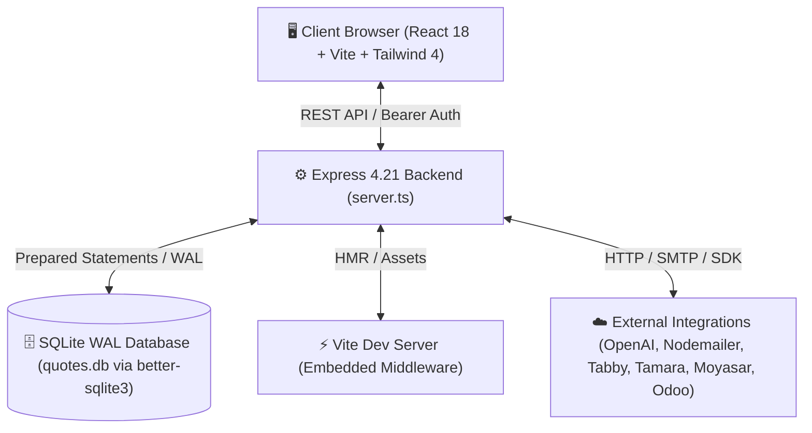
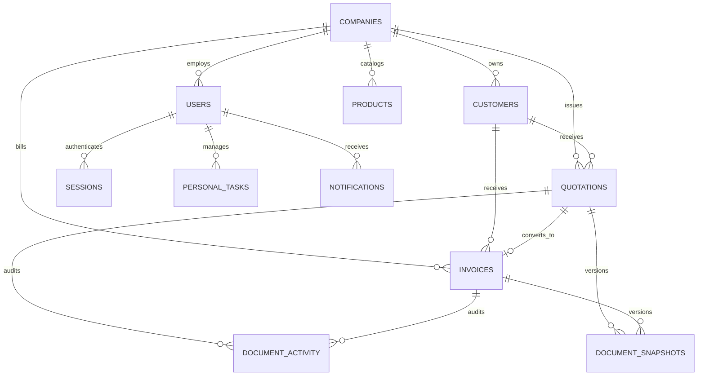

# 🌐 QVOKE ERP — CODEBASE NETWORK & ARCHITECTURAL ATLAS

> **Purpose**: This living blueprint maps every layer, component, hook, store action, API route, database entity, and integration of the Qvoke ERP platform. It serves as an instant-lookup system graph so future modifications can be made accurately without re-scanning the entire project.

---

## 🏛️ 1. High-Level Architecture & Runtime Topology



- **Dual-Port Isolation**:
  - **Port 3000** (`PORT`): Main Business Application (`App.tsx` shell, Sales, Invoicing, Catalog, Customers, Tracking).
  - **Port 3001** (`ADMIN_PORT`): Platform Super-Admin Portal (`PlatformShell.tsx`, Tenant provisioning, global system settings).
- **Frontend Core**: React 18 + TypeScript + Zustand (`useERPStore`) + Tailwind CSS v4 + Lucide Icons + Dnd-Kit (drag & drop reordering) + ExcelJS + React-PDF.
- **Backend Core**: Node.js + Express + `better-sqlite3` (WAL mode enabled) + bcrypt + Helmet + rate-limiter.

---

## 📂 2. File & Directory Graph

```
D:\Devlopment\Qvoke\
├── server.ts                       # Complete Express + SQLite server (APIs, auth, DB migrations, background tasks)
├── package.json                    # Project dependencies & build scripts
├── tsconfig.json                   # TypeScript compiler options
├── vite.config.ts                  # Vite + React plugin configuration
├── quotes.db                       # Active SQLite database file
├── src/
│   ├── main.tsx                    # React DOM root hydration
│   ├── App.tsx                     # Main layout shell, sidebar navigation, dynamic routing & command palette
│   ├── store.ts                    # Central Zustand store (ERPState, state actions, localStorage persistence)
│   ├── types.ts                    # Global TypeScript interfaces & data contracts
│   ├── theme.ts                    # Theme preset tokens, accent color logic & CSS variables
│   ├── index.css                   # Global CSS, theme variables, animations & utility classes
│   ├── mockData.ts                 # Initial demo data & seed structures
│   ├── migrate_data.ts             # Migration scripts from legacy schemas
│   │
│   ├── pages/                      # Page-Level Views (Routable)
│   │   ├── Dashboard.tsx           # Metrics KPIs, recent activity, revenue trends & quick actions
│   │   ├── Tracking.tsx            # Unified Sales Hub (Quotes & Invoices tracking, bulk PDFs/Excel, follow-ups)
│   │   ├── QuotationDetail.tsx     # Full Quotation Editor (Bilingual, MU markup, auto-save, PDF/Email, dnd-kit)
│   │   ├── InvoiceDetail.tsx       # Full Invoice Editor (ZATCA QR, payments ledger, auto-save, PDF/Email)
│   │   ├── Quotations.tsx          # Quotations legacy list view (retained for direct routing fallback)
│   │   ├── Invoices.tsx            # Invoices legacy list view (retained for direct routing fallback)
│   │   ├── Customers.tsx           # Customer directory, billing coordinates & VAT validation
│   │   ├── Products.tsx            # Catalog management (Products/Services, pricing, auto-translation)
│   │   ├── Suppliers.tsx           # Supplier directory & vendor tracking
│   │   ├── BOQ.tsx                 # Bill of Quantities / Bill of Materials structured estimator
│   │   ├── POS.tsx                 # Point of Sale fast barcode/checkout terminal
│   │   ├── MyTasks.tsx             # Personal Kanban task board & action tracker
│   │   ├── Reports.tsx             # Financial analytics, sales performance & tax export reports
│   │   ├── RecycleBin.tsx          # Soft-delete recovery vault (Restore, permanent delete, retention pin)
│   │   ├── Settings.tsx            # Company profile, VAT/CR, sequences, theme, feature flags, API integrations
│   │   ├── Companies.tsx           # Multi-tenant organization switcher & workspace creator
│   │   └── PlatformShell.tsx       # Platform super-admin dashboard (Tenants, system logs, backups, DB vacuum)
│   │
│   ├── components/                 # Shared & Modular UI Components
│   │   ├── AIAssistant.tsx         # Floating conversational AI copilot (ERP query generator & action helper)
│   │   ├── AutoSaveIndicator.tsx   # Visual status badge for live auto-saving (Saved, Saving, Error, Retry)
│   │   ├── CommandPalette.tsx      # Global ⌘K / Ctrl+K quick search and shortcut navigator
│   │   ├── ConfirmDialog.tsx       # Accessible modal dialog for destructive & confirmation actions
│   │   ├── CurrencyInput.tsx       # Formatted monetary input field with currency adornment
│   │   ├── CustomerCombobox.tsx    # Searchable typeahead customer dropdown with quick create
│   │   ├── ProductCombobox.tsx     # Searchable product picker with price auto-fill
│   │   ├── InlineProductSearchInput.tsx # In-grid product search for table rows
│   │   ├── QuickCreateProductModal.tsx # Fast product creation popup without leaving current form
│   │   ├── DatePicker.tsx          # Custom date picker widget with quick interval presets
│   │   ├── DesktopWorkspace.tsx    # Multi-window draggable/resizable OS-style desktop workspace
│   │   ├── DocumentTimeline.tsx    # Audit trail & revision history viewer with diff inspection
│   │   ├── VersionDiffViewer.tsx   # Side-by-side JSON snapshot diff visualizer
│   │   ├── EmailSendModal.tsx      # SMTP email composer with attached document PDF preview
│   │   ├── PDFPreviewModal.tsx     # Live interactive PDF document viewer (@react-pdf/renderer)
│   │   ├── EmptyState.tsx          # Standardized empty data illustration and call-to-action
│   │   ├── ExcelImportExport.tsx   # Excel XLSX file bulk importer/exporter utilities
│   │   ├── KPICard.tsx             # Dashboard metric card with growth percentage indicators
│   │   ├── Login.tsx               # Authentication form with session persistence & demo fast-login
│   │   ├── NotificationBell.tsx    # Top-bar notification popover with unread counters
│   │   ├── PageHeader.tsx          # Standardized page title header with breadcrumbs & actions bar
│   │   ├── SkeletonTable.tsx       # Placeholder shimmer loading states for tables
│   │   ├── SortableTableRow.tsx    # Dnd-Kit wrapped sortable table row with drag handles
│   │   ├── StatusBadge.tsx         # Color-coded status badge (Draft, Confirmed, Paid, Overdue, etc.)
│   │   ├── UsersDB.tsx             # RBAC user management & feature permissions matrix
│   │   └── DatabaseBackupDB.tsx    # Database download, upload, snapshot & restore manager
│   │
│   ├── hooks/                      # Custom React Hooks
│   │   ├── useAutoSave.ts          # Generic debounce-driven auto-save controller with retry logic
│   │   ├── useDebouncedAutosave.ts # Specialized timer debouncer for high-frequency inputs
│   │   └── useDraft.ts             # LocalStorage-backed draft synchronizer for non-blocking navigation
│   │
│   ├── pdf/
│   │   └── quote-document.tsx      # Declarative React-PDF template for official Saudi VAT Quotes & Invoices
│   │
│   └── utils/                      # Pure Utility Helpers
│       ├── lineNumber.ts           # Line item numbering formatters (Sequential, Sectioned, Per-Section)
│       ├── search.ts               # Fuzzy search and multi-token matching algorithms
│       ├── translate.ts            # Arabic/English translation client helper
│       └── zatca.ts                # ZATCA Phase 1 & 2 compliant TLV QR Code generator
```

---

## 🔄 3. State & Reactive Data Network (`src/store.ts`)

```mermaid
graph LR
    subgraph UI Components
        TD[Tracking.tsx]
        QD[QuotationDetail.tsx]
        ID[InvoiceDetail.tsx]
        CD[Customers.tsx]
        PD[Products.tsx]
    end

    subgraph Zustand Store (useERPStore)
        State[(ERPState)]
        Actions[Store Actions & Mutators]
    end

    subgraph Backend API
        API[/api/quotes, /api/invoices, /api/customers, etc.]
    end

    UI Components -->|Subscribe / Select| State
    UI Components -->|Dispatch| Actions
    Actions -->|Async Fetch / Token| API
    API -->|JSON Response| Actions
    Actions -->|Mutate & Cache| State
```

### Key State Slices:
1. **Navigation & Session**:
   - `currentPage`, `currentRecordId`, `activeQuoteId`, `activeInvoiceId`, `token`, `currentUser`, `initialized`, `authChecked`.
2. **Appearance & Workspace**:
   - `theme` (`light` | `dark` | `system`), `density` (`comfortable` | `compact`), `workspaceMode` (`standard` | `desktop`), `themePreset`, `userAccent`.
3. **Core ERP Entities**:
   - `company`, `customers[]`, `products[]`, `quotations[]`, `invoices[]`, `suppliers[]`, `tasks[]`, `companies[]`.
4. **Feature Gating**:
   - `features` (Map of module toggles: `boq`, `bom`, `tracking`, `pos`, `reports`, etc.), `activePlan`.

---

## 🧭 4. Routing & View Topology

All routing is centrally governed by `setRoute(page, id?)` in `store.ts` and resolved inside `App.tsx`:

| Route Identifier | Component Rendered | Purpose / Module |
|---|---|---|
| `dashboard` | `<Dashboard />` | Main analytics, revenue metrics, and overview |
| `tracking` | `<Tracking />` | Unified sales tracking for Quotations & Invoices |
| `quotation-detail` | `<QuotationDetail id={recordId} />` | Create (`new`) or edit quote with pricing calculation |
| `invoice-detail` | `<InvoiceDetail id={recordId} />` | Create (`new`) or edit invoice with ZATCA QR & payments |
| `customers` | `<Customers />` | Customer database, tax numbers, and billing addresses |
| `products` | `<Products />` | Price catalog, items, services, and inventory codes |
| `suppliers` | `<Suppliers />` | Vendor registry |
| `boq` | `<BOQ />` | Bill of Quantities / Bill of Materials builder |
| `pos` | `<POS />` | Fast cashier POS screen |
| `reports` | `<Reports />` | Financial reports, VAT breakdown, profit analysis |
| `tasks` | `<MyTasks />` | Personal task tracker & todo board |
| `recycle-bin` | `<RecycleBin />` | Soft-deleted items recovery vault |
| `settings` | `<SettingsPage />` | System preferences, company details, integrations |
| `companies` | `<Companies />` | Multi-organization switcher & creator |
| `platform-admin` | `<PlatformShell />` | Super-admin tenant management (Port 3001) |

---

## 🔌 5. Backend REST API Matrix (`server.ts`)

| Category | Method | Endpoint | Authorization | Description |
|---|---|---|---|---|
| **Auth** | `POST` | `/api/login` | Public (Rate Limited) | Issues session token with expiration |
| | `POST` | `/api/logout` | `requireAuth` | Destroys active session token |
| | `GET` | `/api/me` | `requireAuth` | Fetches current user profile & permissions |
| **Users & RBAC** | `GET/POST` | `/api/users` | `canManageUsers` | CRUD operations on system users |
| | `GET/POST` | `/api/permission-groups` | `canManageUsers` | Manage security groups & role matrix |
| **Customers** | `GET/POST/PUT/DELETE`| `/api/customers` | `requireAuth` | Full CRUD for customers & addresses |
| **Products** | `GET/POST/PUT/DELETE`| `/api/products` | `requireAuth` | Full CRUD for product catalog |
| **Suppliers** | `GET/POST/PUT/DELETE`| `/api/suppliers` | `requireAuth` | Full CRUD for suppliers |
| **Quotes** | `GET/POST/PUT/DELETE`| `/api/quotes` | `requireAuth` | Quotation lifecycle, line items, versioning |
| | `GET` | `/api/quotes/:id/pdf` | `requireAuth` | Server-rendered React-PDF binary buffer |
| | `GET` | `/api/quotes/:id/timeline`| `requireAuth` | Revision log & audit history |
| **Invoices** | `GET/POST/PUT/DELETE`| `/api/invoices` | `requireAuth` | Invoice lifecycle, payments ledger, ZATCA |
| | `POST` | `/api/invoices/:id/payments` | `requireAuth` | Record partial or full payment |
| **Recycle Bin** | `GET` | `/api/recycle-bin` | `requireAuth` | List soft-deleted quotes & invoices |
| | `POST` | `/api/recycle-bin/:id/restore` | `requireAuth` | Restore deleted item to active state |
| | `DELETE` | `/api/recycle-bin/:id` | `canDeleteData` | Permanently purge item from database |
| | `PATCH` | `/api/recycle-bin/:id/retain` | `requireAuth` | Pin item to prevent auto-clear pruning |
| **Sequences** | `GET/PUT` | `/api/sequences` | `canManageSettings`| Manage numbering prefix, padding, yearly reset |
| **Integrations**| `POST` | `/api/translate` | `requireAuth` | Bilingual text translation (OpenAI / engine) |
| | `POST` | `/api/email/send` | `requireAuth` | Nodemailer SMTP email dispatcher with PDF |
| | `GET/POST` | `/api/integrations/*` | `requireAuth` | Tabby, Tamara, Moyasar, Odoo gateways |
| **System** | `GET/POST` | `/api/logs` | `canManageSettings`| View & clear structured system event logs |
| | `GET/POST` | `/api/admin/backup/*` | Super-Admin | Download raw database backup / restore |

---

## 🗄️ 6. Database Entity Relationship Model (`quotes.db`)



---

## ⚙️ 7. Key Business Logic Engines

1. **Markup & Profit Calculation Engine** (`QuotationDetail.tsx` & `InvoiceDetail.tsx`):
   - Supports rule-based dynamic markup (`MU %`):
     - `EXCL`: Excluded from markup calculation (e.g., Installation).
     - `ZM`: Zero markup (e.g., Materials pass-through).
     - `MAN`: Manual override price.
     - `DB`: Catalog database base price.
2. **Saudi ZATCA E-Invoicing Compliance** (`src/utils/zatca.ts`):
   - Computes TLV (Tag-Length-Value) encoded Base64 QR code containing: Seller Name, VAT Registration Number, Timestamp, Total with VAT, and VAT amount.
3. **Audit Trail & Snapshots Engine** (`DocumentTimeline.tsx` & `VersionDiffViewer.tsx`):
   - On every create/update, deep field diffs are recorded in `document_activity`, and full immutable JSON snapshots are saved in `document_snapshots`.
4. **Resilient Auto-Save & Offline Drafts** (`useAutoSave.ts`, `useDraft.ts`):
   - Debounced background server synchronization with concurrent create deduplication (`committedRef`), backed by zero-loss `localStorage` draft caching.

---

## 🔄 8. Codebase Network Update Protocol

Whenever changes are made to the codebase, follow these rules to keep the network synchronized:
1. **New Route / Page**: Add to `src/App.tsx`, `src/store.ts` (routing map), and section **4. Routing & View Topology** above.
2. **New DB Table / Migration**: Add to `server.ts` initialization block and section **5 & 6** above.
3. **New Zustand State**: Add interface and action signatures to `src/store.ts`, `src/types.ts`, and section **3** above.
4. **New Integration**: Document credentials format in `src/pages/Settings.tsx` and section **5** above.
