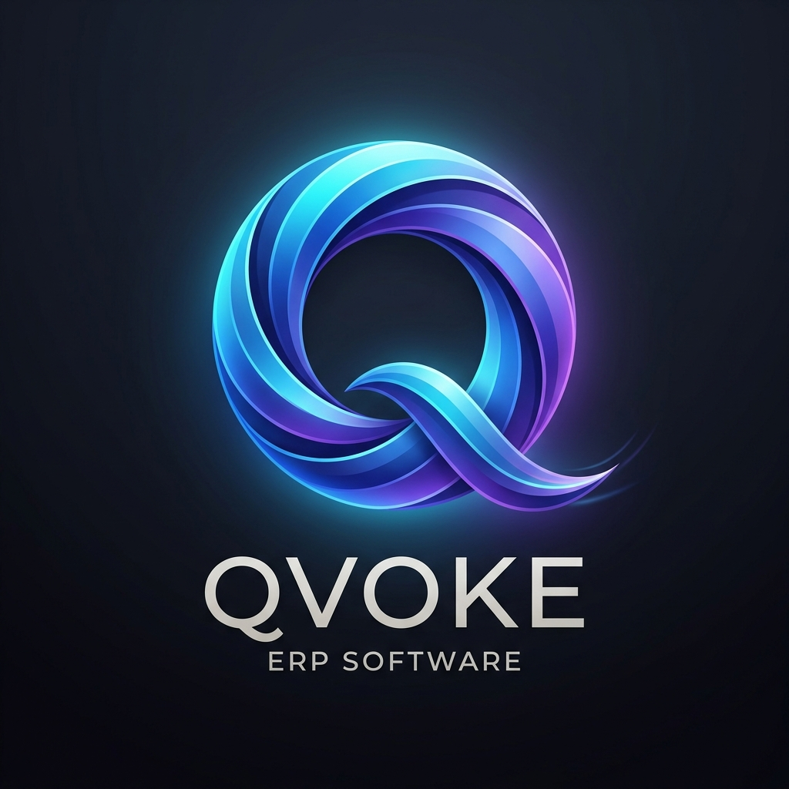
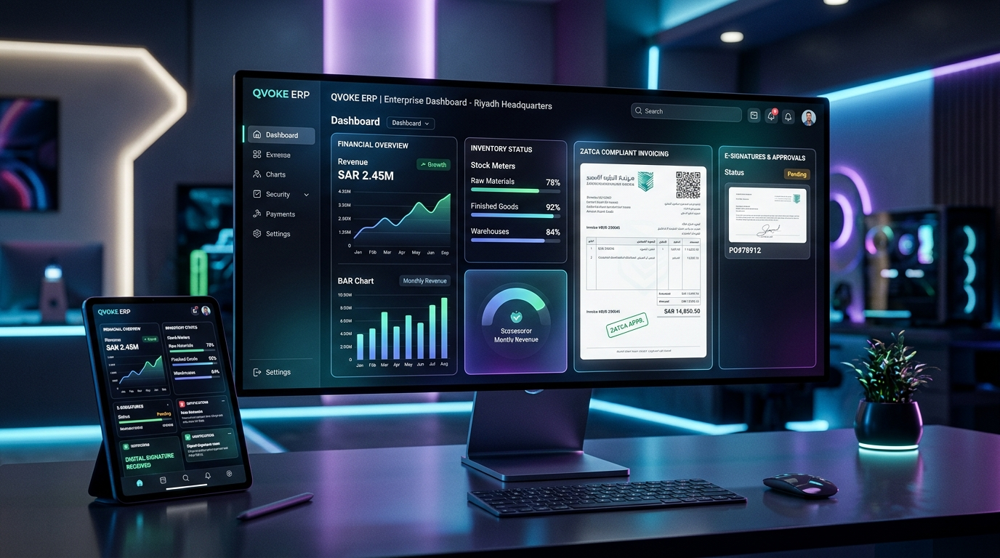

<div align="center">

  

  # Qvoke ERP & Billing

  **A bilingual (English / Arabic), multi-company ERP for quotations, invoicing, POS and light inventory.**

  
  
  

</div>

---

## Contents

1. [What it does](#what-it-does)
2. [Screenshots](#screenshots)
3. [Quick start](#quick-start)
4. [Configuration](#configuration)
5. [Scripts](#scripts)
6. [Architecture](#architecture)
7. [Multi-company model and permissions](#multi-company-model-and-permissions)
8. [API overview](#api-overview)
9. [ZATCA e-invoicing: what is and isn't implemented](#zatca-e-invoicing-what-is-and-isnt-implemented)
10. [Testing](#testing)
11. [Production deployment](#production-deployment)
12. [Backups and restore](#backups-and-restore)
13. [Known limitations](#known-limitations)
14. [Further documentation](#further-documentation)
15. [License](#license)

---

## What it does

| Area | Capabilities |
| :--- | :--- |
| **Quotations** | Sectioned line items, markup (M.U. %) analysis, discounts, manual-total override (permission gated), AR/EN subject and notes, one-click translation, PDF and Excel export, quote → invoice conversion, version snapshots with restore, list and Kanban views. |
| **Invoices** | Same editor as quotations plus payments, partial/paid/overdue states, ZATCA QR code, watermark, public share link. |
| **Tracking** | Follow-up dates and notes per document, overdue indicators, bulk status changes, bulk follow-up, CSV export, bulk PDF/Excel/merged-Excel export. |
| **BOQ / BOM** | Project quantity documents with their own numbering and PDF output. |
| **POS** | Barcode/search checkout, cash/card tender, stock deduction, receipt with ZATCA QR. |
| **Expenses** | Vendor bills with category, VAT breakdown and status. |
| **Recurring billing** | Weekly / monthly / quarterly / annual schedules that generate invoices on demand. |
| **Inventory** | Stock levels, manual adjustments, movement audit log. |
| **Client portal** | Tokenised public links; clients can review, accept (with signature) or decline a quotation/invoice. |
| **Catalog & contacts** | Customers, suppliers, products with Excel import/export. |
| **Admin** | Users and permission groups, per-company feature flags / plans, document numbering rules, default notes & terms, PDF template studio, system logs, database backup/restore, recycle bin with retention. |
| **AI (optional)** | RFQ document parsing and a natural-language data assistant when an OpenRouter / Gemini / OpenAI key is configured. |
| **UI** | 4 UI themes (Modern, Obsidian, Glassmorphism, Neumorphism) × 6 accent colours, light/dark mode, bilingual English/Arabic labels, mobile bottom navigation, command palette, keyboard-accessible dialogs. |

## Screenshots

<div align="center">
  
  <br/><br/>
  
</div>

## Quick start

**Requirements:** Node.js 18+ (20+ recommended), npm 9+. A C/C++ toolchain may be needed the first time `better-sqlite3` and `bcrypt` compile.

```bash
git clone https://github.com/ajnetworksa/Qvoke.git
cd Qvoke
npm install
cp .env.example .env      # then edit as needed
npm run dev
```

- App: <http://localhost:3000>
- Admin backend port: <http://localhost:3001> (same server, separate listener)

On first start the database (`quotes.db`) is created and seeded with a default company and an administrator:

| Username | Password |
| :--- | :--- |
| `admin` (or `admin@ajnetwork.sa`) | `admin123` |

> **Change this password immediately** (Settings → Users), and never expose a deployment that still uses it.

## Configuration

Environment variables (see `.env.example`):

| Variable | Default | Purpose |
| :--- | :--- | :--- |
| `PORT` | `3000` | Main web/API port. |
| `ADMIN_PORT` | `3001` | Secondary listener for the platform admin panel. |
| `NODE_ENV` | `development` | `production` serves the built `dist/` instead of the Vite dev middleware. |
| `DB_PATH` | `quotes.db` | SQLite file location. |
| `BCRYPT_ROUNDS` | `12` | Password hashing cost. |
| `SESSION_EXPIRY_DAYS` | `30` | Login session lifetime. |
| `OPENROUTER_API_KEY` / `GEMINI_API_KEY` / `OPENAI_API_KEY` | – | Enables RFQ parsing, the AI assistant and AI translation fallback. One is enough. |
| `VITE_APP_NAME`, `VITE_BRAND_COLOR` | `Qvoke`, `#01696f` | Branding defaults. |

Company-level settings (logo, VAT number, bank details, numbering, default terms, PDF layout) are edited in the app under **Settings** and stored per company.

## Scripts

| Command | What it does |
| :--- | :--- |
| `npm run dev` | Starts the Express server with Vite in middleware mode (hot reload). |
| `npm run build` | Type-checks (`tsc`) and builds the client to `dist/`. |
| `npm run preview` | Serves the built client with Vite's preview server (no API). |
| `npm test` | Runs `test-suite.ts` against the database in `DB_PATH` (start the server once first so the schema exists). |

## Architecture

```
React 18 + TypeScript + Tailwind 4 + Zustand        (src/)
        │  fetch /api/*   (Bearer session token + X-Company-Id)
Express 4  ── helmet, rate limiting, multer, zod      (server.ts)
        │  better-sqlite3 (WAL)
SQLite  quotes.db  — users, sessions, companies, quotations, invoices,
                     boq, expenses, recurring_invoices, inventory_transactions,
                     public_shares, document_activity, document_snapshots, sequences, …
```

- `src/store.ts` – Zustand store, API client and shared money maths (`calculateTotals`).
- `src/pages/` – screens (quotation/invoice editors, tracking, POS, reports, settings, …).
- `src/components/` – shared UI (dialogs, comboboxes, PDF preview, template studio, …).
- `src/pdf/` – `@react-pdf/renderer` document used for server and client PDFs.
- `server.ts` – schema + lightweight migrations, auth, tenant resolution, all REST routes.

The server **recomputes document totals from line items** on every quote/invoice save; client-sent totals are not trusted (documents with a manual total are the exception).

## Multi-company model and permissions

- Every business row carries a `companyId`; all queries are scoped to the active company, taken from the `X-Company-Id` header (validated against the user's memberships) or the subdomain.
- Roles: `admin` plus permission groups with fine-grained flags (e.g. `canDeleteData`, `canOverridePrice`, `canManageSettings`, `canDatabaseMaintenance`, `canUseAI`, `canUseKanban`).
- Features can be switched per company (plans / feature flags) – disabled features disappear from navigation and are rejected by the API.
- Platform super-admins can manage companies and see platform-wide logs; company admins only see their own.

## API overview

All routes are under `/api`, JSON in/out, and require `Authorization: Bearer <token>` unless noted.

| Group | Routes |
| :--- | :--- |
| Auth | `POST /login` (public), `POST /logout`, `GET /me` |
| Quotations | `GET/POST /quotes`, `PUT/DELETE /quotes/:id`, `PUT /quotes/:id/followup` |
| Invoices | `GET/POST /invoices`, `PUT/DELETE /invoices/:id`, `PUT /invoices/:id/followup` |
| BOQ / BOM | `GET/POST /boq`, `GET/PUT/DELETE /boq/:id` |
| Expenses | `GET/POST /expenses`, `PUT/DELETE /expenses/:id`, `GET /expenses/summary` |
| Recurring | `GET/POST /recurring-invoices`, `PUT/DELETE /recurring-invoices/:id`, `POST /recurring-invoices/:id/process` |
| Inventory | `GET /inventory/logs`, `POST /inventory/adjust` |
| Catalog | `/customers`, `/suppliers`, `/products` (CRUD), `/import/*`, `/export/*` |
| Numbering | `GET /sequences`, `PUT /sequences/:docType`, `GET /sequences/next/:docType` |
| History | `GET /activity/:docType/:docId`, `GET /snapshots/…`, `POST /restore/:docType/:docId/:snapshotId` |
| Recycle bin | `GET /recycle-bin`, `POST /recycle-bin/:id/restore`, `DELETE /recycle-bin/:id`, `PATCH /recycle-bin/:id/retain` |
| Client portal | `POST /portal/generate-link/:docType/:docId`; **public:** `GET /portal/:docType/:token`, `POST …/accept`, `POST …/decline` |
| PDF | `GET /pdf/quotation/:id`, `/pdf/invoice/:id`, `/pdf/boq/:id`, `POST /pdf/generate` |
| Settings | `GET/POST /settings/company`, `GET /settings/:key`, `POST /settings`, `GET/PUT /features` |
| Admin | `/users`, `/permission-groups`, `/companies`, `/admin/*` (backup, restore, optimize, overview), `/logs` |
| AI / utilities | `POST /translate`, `POST /rfq/parse`, `POST /ai/chat`, `GET /currency/rates` |

## ZATCA e-invoicing: what is and isn't implemented

Implemented (**Phase 1**): invoices and POS receipts carry the standard TLV Base64 QR code with the five required tags – seller name, VAT registration number, timestamp, invoice total with VAT, and VAT amount (`src/utils/zatca.ts`).

**Not implemented (Phase 2 / Fatoora integration):** cryptographic stamping/signing, UBL XML generation, CSID onboarding, and clearance/reporting API calls. Do not rely on this software alone for Phase 2 compliance.

Make sure the company profile has the correct legal name and 15-digit VAT number, because they are encoded in the QR.

## Testing

```bash
npm run dev          # once, so quotes.db / DB_PATH gets its schema (stop with Ctrl+C)
npm test             # or: DB_PATH=/path/to/quotes.db npx tsx test-suite.ts
```

The suite exercises tenant isolation, numbering, stock deduction, expense maths, recurring schedules, the portal signature flow and ZATCA TLV encoding directly against SQLite. It does not cover the UI; type-check and build with `npm run build`.

## Production deployment

```bash
npm ci
npm run build
NODE_ENV=production npx tsx server.ts
```

- Put a TLS-terminating reverse proxy (nginx, Caddy, …) in front; the app does not terminate HTTPS itself.
- Persist `quotes.db` (plus its `-wal`/`-shm` files) and the `backups/` directory on a volume.
- Change the seeded admin password and set an AI key only if you want AI features.
- Run behind a process manager (systemd, pm2, Docker) so the "restart after restore" behaviour brings the server back.

## Backups and restore

Settings → Maintenance can create, download, delete and restore database backups (requires `canDatabaseMaintenance`). Restores validate the file (SQLite integrity check and expected tables) before replacing the live database, then restart the process. Always keep an off-server copy of `backups/`.

## Known limitations

- Document numbers are unique per company, and each company has its own counters. On first start after upgrading, a one-time migration (with an automatic backup in `backups/`) gives every existing company a copy of the old counter; new companies start from 0 with the same prefix format.
- Quote terms are a single free-text field per document, with company-wide defaults in Settings → Document.
- The offline PWA shell is not implemented: `manifest.json` makes the app installable, but there is no service worker.
- Only the ZATCA Phase 1 QR is produced (see above).

## Further documentation

- [`CHANGES.md`](CHANGES.md) – change log (latest audit and fixes first).
- [`CODEBASE_NETWORK.md`](CODEBASE_NETWORK.md) – map of layers, components, store actions, routes and tables.
- [`SESSION_SUMMARY.md`](SESSION_SUMMARY.md) – previous working notes.

## License

Proprietary software – **AJ Network Solutions** © 2025–2026. All rights reserved.
